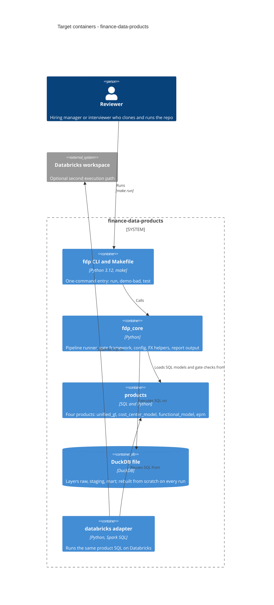

# Architecture map — finance-data-products

> **Greenfield foundation** (`mode: greenfield-bootstrap`): the C4, module inventory and conventions
> below describe the **target baseline** that `scaffold` will materialize, not code that exists yet.
> Foundation decided with the owner in the `survey` session on 2026-11-04 (guided-explained depth)
> on top of [`idea-brief.md`](./idea-brief.md). After `scaffold`, refresh with `survey` (brownfield).
> No authored architecture doc exists; this map is the reference.

## Stack

- Language / runtime: Python 3.12 (`pyproject.toml`, to be created by scaffold S1) — ADR-0001
- Engine: DuckDB (embedded, single `.duckdb` file, no accounts or servers) executing dialect-neutral SQL files — ADR-0001
- Second execution path: Databricks (Spark SQL) running the same SQL through a thin adapter in `databricks/` — ADR-0004
- Build / test / lint (the decided toolchain, feeds `implement` detection):
  - setup: `make setup` (create venv, install the package with dev extras)
  - run: `make run` (one-command local run of the current product, gates included)
  - negative demo: `make demo-bad` (deliberately corrupted data, gates are expected to FAIL)
  - test: `pytest` (`make test`)
  - lint: `ruff check .` (`make lint`)
  - CI: one GitHub Actions workflow, `.github/workflows/ci.yml` (setup + lint + test)
- Frontend: none. Power BI is an open question in the brief (`idea-brief.md` §8); the mart is exposed as Parquet/CSV export if it enters scope.

## C4 — target system (baseline to scaffold)

## Module inventory

Target layout (nothing exists yet; scaffold creates it). Products 2-4 are reserved placeholders (a `README.md` stating status) so the roadmap and the folder tree already match 1:1.

| Module | Path | Layers | Wired at | Responsibility |
|---|---|---|---|---|
| fdp_core | `src/fdp_core/` | runner, gates, config, fx, report | `src/fdp_core/cli.py` (entry point `fdp`) | Shared engine: build the DuckDB layers from a product's SQL, run its gates, report PASS/FAIL, set the exit code |
| unified_gl | `products/unified_gl/` | `sql/` (raw, staging, mart), `gates/`, `data/`, `README.md` | `products/unified_gl/product.toml` | Product 1: two ERP exports in different formats and currencies unified into one USD ledger |
| cost_center_model | `products/cost_center_model/` | same shape as unified_gl | `products/cost_center_model/product.toml` | Product 2 (reserved, if time): cost-center reference model from synthetic CSV |
| functional_model | `products/functional_model/` | same shape as unified_gl | `products/functional_model/product.toml` | Product 3 (reserved, if time): function > sub-function > department > cost-center hierarchy plus Mermaid tree |
| epm | `products/epm/` | same shape as unified_gl | `products/epm/product.toml` | Product 4 (reserved only): profitability by function from Unified GL plus simple allocation rules; depends on 1-3 |
| databricks | `databricks/` | adapter, notebook/job definitions | `databricks/README.md` | Second execution path over the shared SQL; compatibility claims only after a real run |
| tests | `tests/` | `unit/`, `integration/` | `pyproject.toml` (pytest config) | Core tests plus one green and one red scenario per implemented product |
| docs | `docs/` | brief, map, ADRs, per-feature specs | n/a | Pipeline artifacts and the reader-facing documentation |

## Conventions (the rules a new feature must match)

Target conventions, fixed by the foundation. Because no code exists yet, each line cites the file that will carry the rule (created by the scaffold tasks) or the ADR that decides it.

- **Module wiring / registration:** each product is a folder with a `product.toml` manifest (name, layer SQL order, gate list, data inputs); `fdp_core` discovers products under `products/` by that manifest — ADR-0002, `products/unified_gl/product.toml`
- **Error handling:** a failed gate is a normal result, not an exception. Each gate yields `PASS`/`FAIL` with violating rows; the runner prints a table, writes a JSON report, and exits non-zero on any FAIL before the mart is published. Unexpected faults raise typed errors from `src/fdp_core/errors.py` — ADR-0003
- **Gates:** one SQL file per check in `products/
/gates/NN_<name>.sql`, written so that **zero returned rows means PASS**; non-SQL checks (e.g. cycle detection) are Python functions registered in the same list — `src/fdp_core/gates.py`
- **IDs:** deterministic surrogate keys computed as a hash of the business-key fields (no random UUIDs), so reruns are byte-identical — `products/unified_gl/sql/` — ADR-0003
- **Persistence / DB access:** DuckDB file in `build/` (gitignored), rebuilt from scratch each run; layers are schemas `raw` -> `staging` -> `mart`; SQL stays dialect-neutral (ANSI plus functions available in both DuckDB and Spark SQL) — ADR-0003, ADR-0004
- **Migrations:** none. Schema is the DDL in the layer SQL files; there is no migration tool (`migration_tool: ""`) — ADR-0003
- **Tests:** `pytest` under `tests/`; core unit tests plus, per product, one green scenario (clean synthetic data passes all gates) and one red scenario (corrupted data makes the named gate fail) — `tests/integration/test_unified_gl.py`
- **Inter-module communication:** products never import each other. A dependent product (EPM) reads the upstream product's published `mart` tables through the DuckDB file or its export, not through Python calls — ADR-0002
- **Synthetic data:** generated deterministically (fixed seed) by `products/
/data/generate.py`; committed CSVs under `products/
/data/` are small enough to read; "bad" variants are produced by the same generator with a corruption flag — `products/unified_gl/data/generate.py`
- **UI / styling:** n/a (no frontend)

## Datastores

| Store | Engine | Accessed via | Notes |
|---|---|---|---|
| `build/fdp.duckdb` | DuckDB | `duckdb` Python package, SQL files | Ephemeral, gitignored, rebuilt on every run; layers `raw`, `staging`, `mart` |
| Databricks tables | Delta on Databricks | Spark SQL through `databricks/` adapter | Optional path; access to a workspace is unconfirmed (`idea-brief.md` §8) |
| `products/
/data/*.csv` | CSV files | read by `raw` layer SQL | Synthetic inputs, committed |

## Frontend / UI foundation

<!-- N/A: no frontend -->

## Where things live / closest precedents

- A new data product -> `products/<name>/` with `product.toml`, `sql/`, `gates/`, `data/`, `README.md`, modelled on `products/unified_gl/` (the first product built; it becomes the precedent for the others).
- A new quality gate -> `products/
/gates/NN_<name>.sql` (zero rows = PASS) and one red test in `tests/integration/`.
- Shared behaviour (runner, reporting, FX lookup, config) -> `src/fdp_core/`, never copied into a product.
- Databricks-specific code -> `databricks/` only; product SQL must stay runnable on both engines.
- No code precedent exists yet; `scaffold` creates the first ones.

## Constraints & known tech-debt

- Synthetic data only, no real ERP connection (`idea-brief.md` §5) — shapes the whole data layer; no production hardening.
- Time box: roughly one week from 2026-11-04, 10+ hours; order of cutting is products 3 and 2 first, EPM only reserved (`idea-brief.md` §6) — keep the skeleton minimal.
- Databricks workspace access is unknown — the Databricks path must not be advertised as compatible in the README before a real run (`idea-brief.md` §6 risk 2).
- Dialect-neutral SQL limits the use of DuckDB-only features (and Spark-only ones); a needed dialect difference goes into the adapter, not into the product SQL — ADR-0004.
- Autotests were not required by the owner; they are kept small because green CI and a provable failing gate are cheap credibility (ADR-0001 consequences).
- Power BI scope is unresolved (`idea-brief.md` §8); do not design around it yet.

## Reconciliation with the authored architecture doc

No authored architecture doc; this map is the current reference. Foundational decisions are recorded in `docs/adr/0001` to `0004`.
