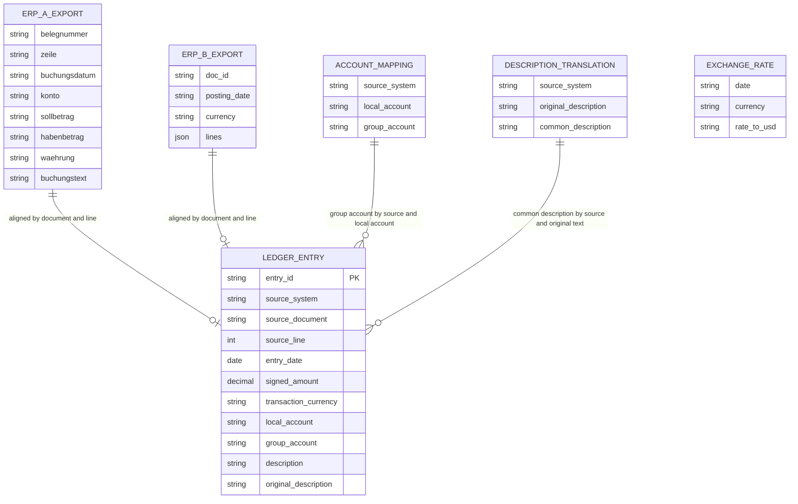

# Data model — unified-gl-inputs

> **Conventions followed.** Repo ADR-0003: DuckDB file rebuilt from scratch on every run, schema = DDL in the layer SQL files, **no migration tool**. Repo ADR-0004 / spec §6: product SQL is dialect-neutral, engine specifics live in `products/unified_gl/adapters/<engine>/`. Repo ID rule: deterministic hash of business keys. Greenfield, so no audit columns, no soft delete, no `CHECK`/trigger/`DEFAULT` is used (the data is regenerated, never edited). Owner decisions of this stage: ERP A is German, ERP B is English, the common language is English; staged DDL pairs are design DDL for `implement` to move into the adapter and SQL folders (see «Staged DDL» below).

## ER diagram

Relations are logical (matched by value in SQL). No foreign keys are declared, because uniqueness and reference problems are handled by the invariant checks and gates (ADR-0003), not by engine constraint errors.

`EXCHANGE_RATE` has no relation in this step: it is loaded and not read (roadmap step 3 reads it).

## Aggregates

| Aggregate root | Members | Layer / schema | Notes |
|---|---|---|---|
| ERP A export row | `raw.erp_a_export` (one row = one entry) | `raw` | Kept as it arrived, every value is text |
| ERP B document | `raw.erp_b_export` with its nested `lines` | `raw` | Stays nested (AC-03, feature ADR-0005); `lines` is part of the document, not a table |
| Account mapping | `raw.account_mapping` | `raw` | Reference data, independent root |
| Description translation | `raw.description_translation` | `raw` | Reference data, independent root |
| Exchange rate | `raw.exchange_rate` | `raw` | Reference data, independent root, not read in this step |
| Ledger entry | `staging.ledger_entry` | `staging` | The aligned entry set, root with no children |
| Typed views / control views | `raw.typed_erp_a`, `raw.typed_erp_b`, `raw.control_erp_a`, `raw.control_erp_b` | `raw` | Views, not stored data; contract in «Views» below |

## Entities

Types in the neutral SQL (`staging.ledger_entry`, gates, invariants, reports) use the vocabulary both engines accept: `STRING`, `INTEGER`, `DECIMAL(18,2)`, `DATE`, `BOOLEAN`. Spark SQL rejects `VARCHAR` without a length, and the spec gives no length limit (AC validation limits are all about dates and amounts), so text is `STRING` (an alias of `VARCHAR` in DuckDB). The `raw` tables are created in the engine adapters, which may use the engine's own type name (`VARCHAR` in the DuckDB adapter); the tables below write `VARCHAR` for raw text columns.

### `raw.erp_a_export`

File: `products/unified_gl/data/erp_a_export_synthetic.csv` — delimiter `;`, header row, UTF-8, LF, German column names, one row per entry. Date `DD.MM.YYYY`, number `1.234,56` (thousands `.`, decimal `,`), exactly one of debit and credit filled.

| Column | Type | Constraints | Notes |
|---|---|---|---|
| `belegnummer` | VARCHAR | — | document number (explicit, AC-05) |
| `zeile` | VARCHAR | — | line number within the document (explicit, AC-05) |
| `buchungsdatum` | VARCHAR | — | posting date, text `DD.MM.YYYY` |
| `konto` | VARCHAR | — | local account (ERP A chart, 4 digits) |
| `sollbetrag` | VARCHAR | — | debit, text; empty when the entry is a credit |
| `habenbetrag` | VARCHAR | — | credit, text; empty when the entry is a debit |
| `waehrung` | VARCHAR | — | transaction currency (EUR, GBP, USD) |
| `buchungstext` | VARCHAR | — | description in German |

**Aggregate root:** root.
**Access patterns:** read once by `raw.typed_erp_a` and once by `raw.control_erp_a`; looked up by `(belegnummer, zeile)` in the gate comparison and in the invariant «unique document and line».
**Constraints:** none in DDL. `(belegnummer, zeile)` unique per source system is enforced by the invariant check, not by the engine.

### `raw.erp_b_export`

File: `products/unified_gl/data/erp_b_export_synthetic.json` — one pretty-printed JSON array of document objects (feature ADR-0005), English field names, fixed key order. Date `MM/DD/YYYY`, number `-1,234.56` (thousands `,`, decimal `.`, leading `-` for a credit). All JSON values are strings, so nothing is parsed by the file reader.

| Column | Type | Constraints | Notes |
|---|---|---|---|
| `doc_id` | VARCHAR | — | document number |
| `posting_date` | VARCHAR | — | text `MM/DD/YYYY`, one per document |
| `currency` | VARCHAR | — | one transaction currency per document (AC-05) |
| `lines` | ARRAY of STRUCT(`line_no` VARCHAR, `account` VARCHAR, `amount` VARCHAR, `memo` VARCHAR) | — | nested lines; `amount` is signed text, `memo` is the description in English |

**Aggregate root:** the document (`doc_id`) owns its `lines`.
**Access patterns:** flattened with `unnest`/`explode` by `raw.typed_erp_b` and `raw.control_erp_b`; matched by `(doc_id, line_no)`.
**Constraints:** none in DDL. `(doc_id, line_no)` unique is enforced by the invariant check.

### `raw.account_mapping`

File: `products/unified_gl/data/account_mapping_synthetic.csv` — comma delimited, header row.

| Column | Type | Constraints | Notes |
|---|---|---|---|
| `source_system` | VARCHAR | — | `ERP_A` or `ERP_B` |
| `local_account` | VARCHAR | — | account code in that source system's chart; the same code can occur in both systems with different group accounts (AC-04) |
| `group_account` | VARCHAR | — | account of the common chart |

**Aggregate root:** root.
**Access patterns:** lookup by `(source_system, local_account)` → alignment join and invariant «unambiguous mapping» (`count(*) > 1` per key).
**Constraints:** `(source_system, local_account)` occurs in exactly one row (AC-11, after `clarify`: a repeat with the same or another group account is an error), enforced by the invariant check.

### `raw.description_translation`

File: `products/unified_gl/data/description_translation_synthetic.csv`.

| Column | Type | Constraints | Notes |
|---|---|---|---|
| `source_system` | VARCHAR | — | `ERP_A` or `ERP_B` |
| `original_description` | VARCHAR | — | description exactly as the source wrote it |
| `common_description` | VARCHAR | — | the same text in the common language (English) |

**Aggregate root:** root.
**Access patterns:** lookup by `(source_system, original_description)` → alignment join and the exceptions report.
**Constraints:** `(source_system, original_description)` unique by construction of the generator (a duplicate would multiply entries; the invariant «unambiguous translation» stops the run first and names the repeated description, so it is never reported as a repeated entry id).
**Design note:** ERP B is already in English, so the generator writes identity rows (`original = common`) for its descriptions. This keeps the neutral SQL uniform: one left join for both systems, and «no translation row» always means «exceptions report», without a per-system language rule.

### `raw.exchange_rate`

File: `products/unified_gl/data/rates_synthetic.csv` (name fixed by AC-05 after `clarify`) — columns `date`, `currency`, `rate_to_usd` as in AC-05.

| Column | Type | Constraints | Notes |
|---|---|---|---|
| `date` | VARCHAR | — | ISO `YYYY-MM-DD`, one row per currency (USD included, rate 1) per calendar day, 2026-01-01 to 2026-03-31 |
| `currency` | VARCHAR | — | EUR, GBP, USD (USD rate is 1) |
| `rate_to_usd` | VARCHAR | — | decimal text with `.`; loaded as text, parsed in step 3 |

**Aggregate root:** root.
**Access patterns:** none in this step.
**Constraints:** none; completeness of rates (exactly one rate per currency and day) is checked by the generator's input checks (SAD Flow 3), not by the product run.

### `staging.ledger_entry` (aligned entry set)

Created in neutral SQL (`products/unified_gl/sql/staging/`), one row per accepted entry of either source system. This is the stable contract for roadmap step 3 and is documented attribute by attribute in the product README (AC-14).

| Column | Type | Constraints | Notes |
|---|---|---|---|
| `entry_id` | STRING | NOT NULL, unique (invariant) | `md5(source_system \|\| '\|' \|\| source_document \|\| '\|' \|\| source_line)`, 32 hex characters, deterministic (AC-06); `source_line` is hashed as an integer, so «01» and «1» give the same identifier, the document as written in the source with trimmed spaces |
| `source_system` | STRING | NOT NULL | `ERP_A` or `ERP_B` (US-04) |
| `source_document` | STRING | NOT NULL | original document number (US-04) |
| `source_line` | INTEGER | NOT NULL | original line number (US-04) |
| `entry_date` | DATE | NOT NULL | real calendar date (AC-02) |
| `signed_amount` | DECIMAL(18,2) | NOT NULL, ≠ 0 | debit positive, credit negative; scale 2, never rounded (spec §6) |
| `transaction_currency` | STRING | NOT NULL | EUR, GBP or USD in the data; the run summary lists the currencies found here (AC-14) |
| `local_account` | STRING | NOT NULL | account in the source's own chart |
| `group_account` | STRING | NULL allowed | NULL = no mapping row; the mapping gate fails on it (AC-10) |
| `description` | STRING | NOT NULL | common language; the original text when no translation exists (AC-02) |
| `original_description` | STRING | NOT NULL | the source's text; needed by the exceptions report, which cannot tell «untranslated» from «translated» using `description` alone |

**Aggregate root:** root (no children).
**Access patterns:** see «Access paths» below.
**Constraints:**
- `NOT NULL` on all columns except `group_account`. An entry whose key fields (document, line), currency or local account are empty is treated as unreadable together with the AC-09 cases (AC-09 says «including», so the list is open), because a `NOT NULL` violation would otherwise surface as an engine error instead of a «lost entry» in the completeness gate.
- No `PRIMARY KEY`/`UNIQUE` in DDL: on a repeated key DuckDB would raise a constraint exception before the invariant check can raise the typed `InvariantViolation` that names source system, document and line (AC-06, feature ADR-0003). Uniqueness of `entry_id` and of `(source_system, source_document, source_line)` is enforced by invariant checks.
- No `DEFAULT`, `CHECK`, trigger, audit column or soft delete: the repo uses none, the file is rebuilt from scratch on every run and the data is never edited.

## Views

Views are not stored data; they are the contract between the adapters and the neutral SQL. The names and column types are the contract (feature ADR-0001, ADR-0002); the expressions are engine-specific and live in `adapters/<engine>/`.

### `raw.typed_erp_a`, `raw.typed_erp_b` (typed views, feed the alignment)

| View | Column | Type | Notes |
|---|---|---|---|
| both | `source_system` | VARCHAR | constant `ERP_A` / `ERP_B` |
| both | `document` | VARCHAR | trimmed |
| both | `line` | INTEGER | NULL unless the trimmed text is whole digits only (`1.5`, `+1`, `x` are unreadable, never rounded) |
| both | `entry_date` | DATE | NULL when not exactly the source format or not a real date |
| both | `currency`, `local_account` | VARCHAR | NULL when empty |
| both | `description` | VARCHAR | exactly as written (not trimmed), empty string when absent |
| `typed_erp_a` | `debit_filled`, `credit_filled` | BOOLEAN | the source cell is not empty. Needed so that «debit filled but unreadable» is not mistaken for «debit empty» (AC-09: both filled is unreadable) |
| `typed_erp_a` | `debit`, `credit` | DECIMAL(18,2) | NULL when the cell is empty or not a non-negative number with at most 2 decimals in German format |
| `typed_erp_b` | `amount` | DECIMAL(18,2) | NULL when not a number with at most 2 decimals in US format; sign is kept |

Acceptance rule (in neutral SQL, `04_create_staging_ledger_entry`): `entry_date` is not NULL, the signed amount is not NULL and not 0 (ERP A: exactly one of `debit_filled`/`credit_filled` is true, `debit` positive or `-credit`), document, line, currency and local account are present.

### `raw.control_erp_a`, `raw.control_erp_b` (control views, raw side of the completeness gate)

One row per **raw** entry, unreadable ones included. Parsing is written separately from the typed views (feature ADR-0002).

| Column | Type | Notes |
|---|---|---|
| `source_system`, `document`, `line`, `currency`, `local_account` | VARCHAR / INTEGER | as in the typed views; `document` is NULL when empty |
| `line_text` | VARCHAR | trimmed source text of the line, so the invariant «unique document and line» can also find a duplicate whose line is unreadable |
| `entry_date` | DATE | NULL when unreadable |
| `signed_amount` | DECIMAL(18,2) | NULL when the entry is unreadable for any reason (date, key, currency, account, amount, both/neither side filled, negative or zero or over-precise amount), so an unreadable entry counts as an entry and adds nothing to the debit and credit totals (AC-09) |

The gate derives the raw debit total as the sum of positive `signed_amount`, the raw credit total as the sum of the negated negative values, and compares each raw entry with its aligned entry by `(source_system, document, line)` for `entry_date`, `signed_amount` and `local_account`.

## Indexes

No physical indexes. The skill asks for one index per real query; here every query is listed, but none earns a physical index, for these reasons: the data is 100–250 entries per export (spec §6), so a scan is the fastest plan; Spark SQL/Delta has no secondary indexes, so an index would break the shared SQL (repo ADR-0004); the repo has no index anywhere. No `REFERENCES` exist, so the «index every FK» rule has nothing to apply to. The table lists the lookup keys so a physical index (DuckDB-only, in the adapter) can be added if the data ever grows.

| Access path | Columns | Query it serves |
|---|---|---|
| Entry comparison | `staging.ledger_entry (source_system, source_document, source_line)` with `control_*(source_system, document, line)` | completeness gate, per-entry comparison (AC-07, AC-08; SAD Flow 6) |
| Entry id uniqueness | `staging.ledger_entry (entry_id)` | invariant «unique entry id» and the identifier check of SAD Flow 7 (AC-06) |
| Document and line uniqueness | `control_erp_a`/`control_erp_b (document, line)` | invariant «unique document and line» (AC-06) |
| Mapping lookup | `raw.account_mapping (source_system, local_account)` | alignment join (AC-04), invariant «unambiguous mapping» (AC-11) |
| Mapping gate | `staging.ledger_entry (group_account)` | mapping gate: rows with NULL `group_account` (AC-10) |
| Translation lookup | `raw.description_translation (source_system, original_description)` | alignment join and exceptions report (AC-02) |
| Summary | `staging.ledger_entry (source_system, transaction_currency)` | run summary: entries, debit and credit totals per source and currency (AC-01, AC-14) |

## Staged DDL

The repo has no migration tool (`migration_tool: ""`), so these are **design DDL pairs**, not migrations to be applied to a live schema. They were executed against DuckDB 2.0.0 with a small edge-case data set (see the audit report) and each `.down.sql` was run in reverse order.

| Staged pair | Creates | Goes to (when `implement` builds it) |
|---|---|---|
| `migrations/01_create_raw_inputs` | the five `raw.*` input tables | `products/unified_gl/adapters/duckdb/` (engine specific: file readers) |
| `migrations/02_create_typed_views` | `raw.typed_erp_a`, `raw.typed_erp_b` | `products/unified_gl/adapters/duckdb/` |
| `migrations/03_create_control_views` | `raw.control_erp_a`, `raw.control_erp_b` | `products/unified_gl/adapters/duckdb/` |
| `migrations/04_create_staging_ledger_entry` | `staging.ledger_entry` and its fill query | `products/unified_gl/sql/staging/` (neutral SQL) |

Other schema work is not staged: the `raw`, `staging`, `mart` schemas are created by `fdp_core` on every rebuild; the Databricks adapter repeats pairs 01–03 in Spark SQL at roadmap step 6.

## Test fixtures

Not in `migrations/`. Fixtures follow the repo's form (Python generator plus pytest, architecture map «Synthetic data»). PII guard: every name, company and description is fictitious; no real-looking personal data exists.

- `generate.py` (`products/unified_gl/data/`) — writes the five committed files from a fixed seed with amounts built from integer cents; also returns the list of expected aligned entries (`entry_id`, signed amount, group account, common description) so tests can compare `staging.ledger_entry` with known values (SAD §10 QG-1, covers a misreading that both parsers would share).
- Clean data: about 150 entries per export, Q1 2026, EUR/GBP/USD, balanced documents, at least one local account code that occurs in both charts with different group accounts (AC-04), a few ERP A descriptions without a translation row so that the exceptions report is non-empty on clean data (AC-01).
- `tests/` helper `corrupt(...)` for roadmap step 4 (not built here): unreadable date, both debit and credit filled, duplicate document and line, ambiguous mapping, deleted aligned entry. Edge-case rows used by this stage to validate the DDL are listed in the audit report.
