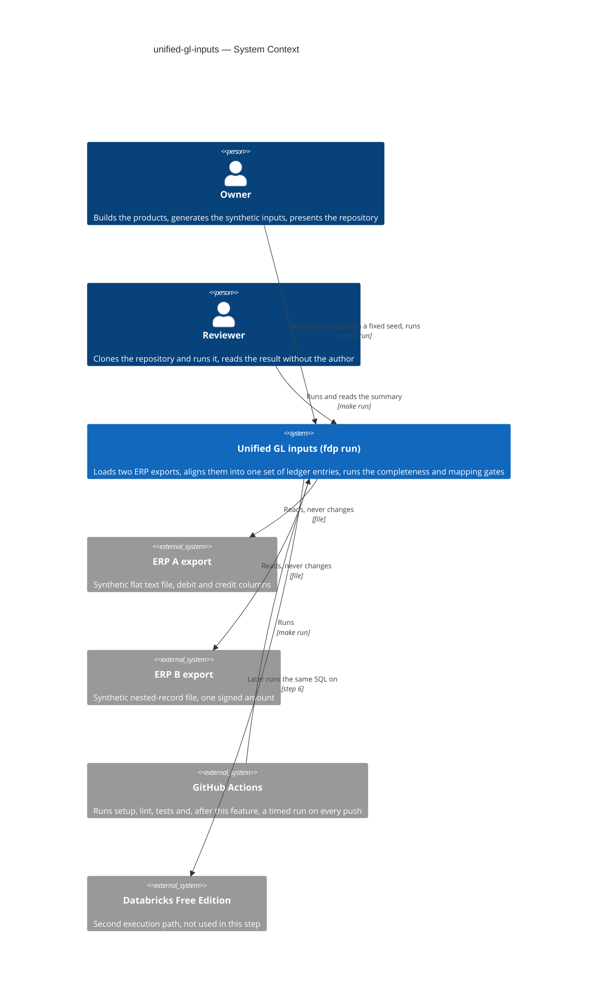
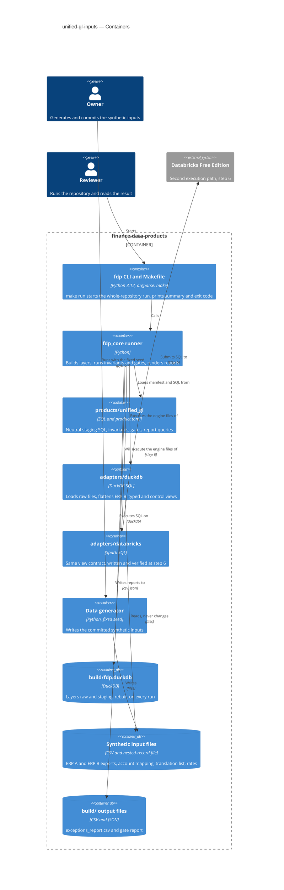
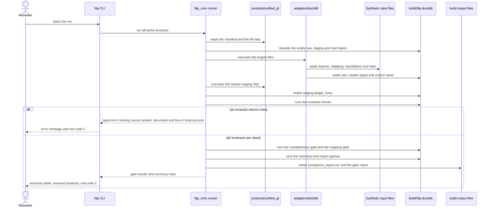
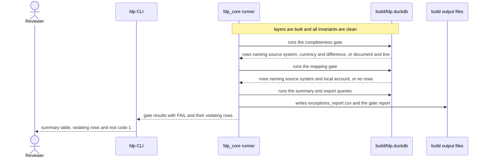
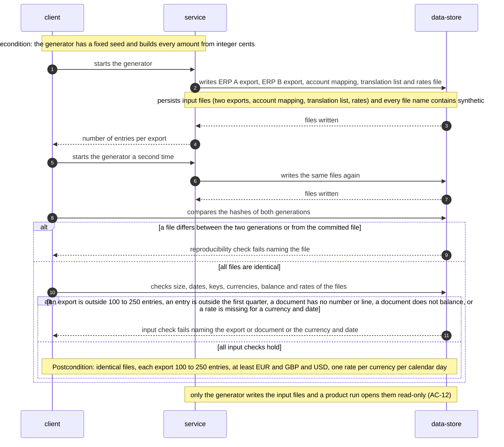
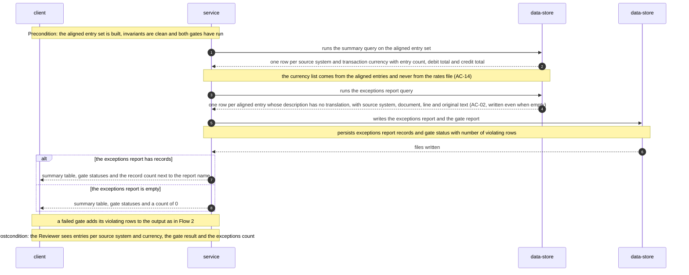
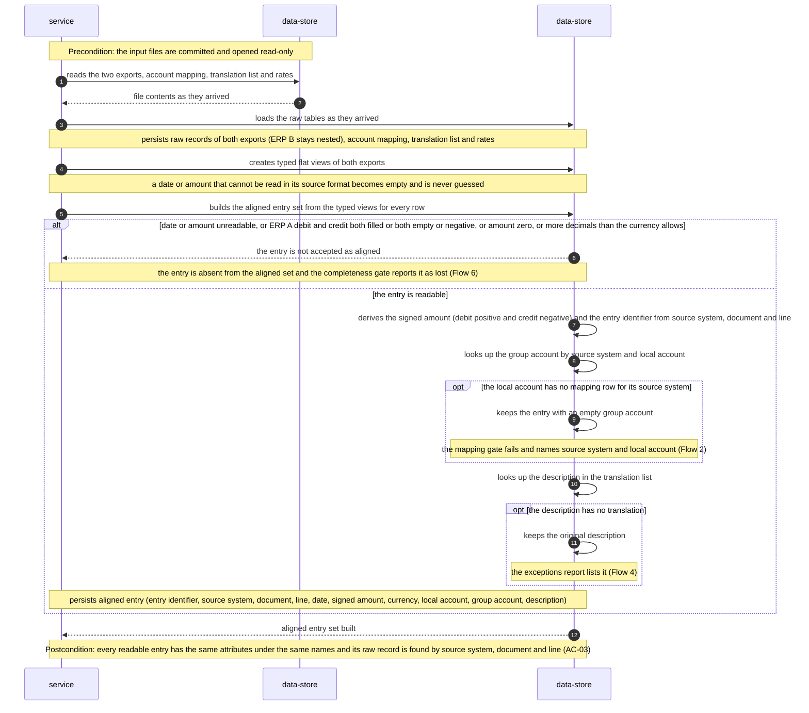
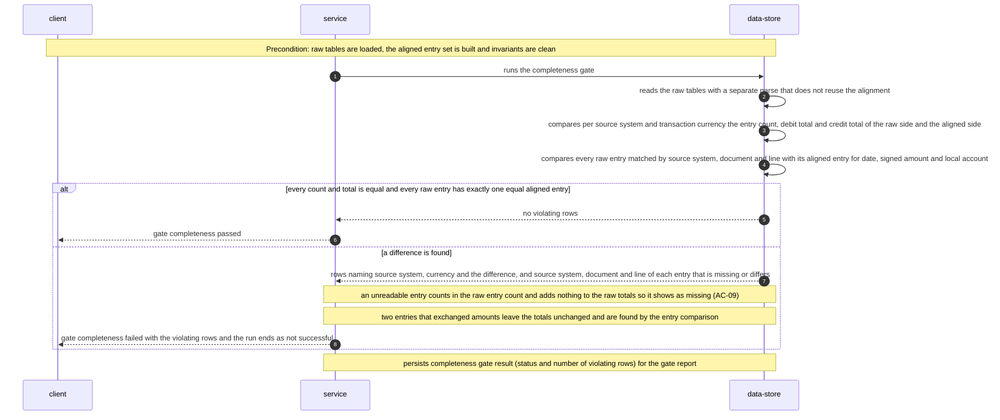
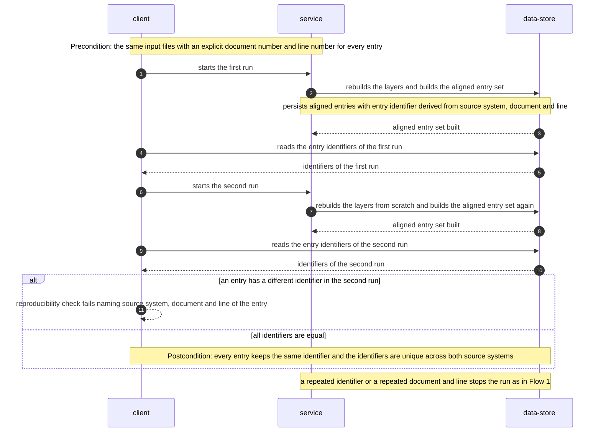

# Software Architecture Document — unified-gl-inputs

<!-- 12 Arc42 sections. Empty section → <!-- N/A: <one-line reason> -->. -->
<!-- C4 Context (L1) lives inline in §3. C4 Container (L2) lives inline in §5. -->
<!-- Numbers in §10 come VERBATIM from spec.md §6 NFR — no inventing, no rounding. -->

## 1. Introduction and goals

**Intent.** The Owner is building a portfolio repository whose first data product, Unified GL, turns two ERP exports into one consistent ledger. This feature is its first slice: two synthetic ERP exports that visibly differ (date format, number format, amount representation, column names and language, chart of accounts) are loaded and aligned into one common set of ledger entries, still in each entry's transaction currency, each entry traceable to its source system, document and line. A Reviewer runs one command and sees that both exports arrived completely and that two gates (completeness, mapping) guard the result. The aligned set is the stable base for roadmap step 3 (USD conversion and the mart).

**Top-3 quality goals (1-liners; full scenarios in §10):**

1. **Completeness** — no entry or amount is lost between the raw files and the aligned entries; the completeness gate proves it with counts, separate debit and credit totals and a per-entry comparison (spec §6, KPI «0 lost»).
2. **Reproducibility** — a fresh generation gives files byte-identical to the committed ones and to a second fresh generation, and two runs give identical entry identifiers (spec §6).
3. **Portability** — the product SQL carries no engine-specific construct; engine differences live in one adapter folder per engine (spec §6, repo ADR-0004).

**Stakeholders.**

| Role | Interest | Sign-off owner? |
|---|---|---|
| Owner | Builds the product, generates the data, presents it in the interview; needs a stable entry set for step 3 | No |
| Reviewer | Reads the repository, runs one command, follows an entry from raw to aligned form; does not consume the numbers | No |
| Tech Lead | SAD approval | Yes |

- Decision override: adapters live in `products/unified_gl/adapters/<engine>/`, not only in the top-level `databricks/` folder — rationale: spec §6 requires one adapter folder per engine for the product-specific file reading and locale parsing; the top-level `databricks/` folder keeps only the code that submits SQL to the workspace (repo ADR-0004), so `CLAUDE.md` and the architecture map should be read with this refinement.
- Decision override: reports (`exceptions_report.csv`, gate report) are written also when a gate fails — rationale: repo ADR-0003 protects the `mart` layer, which this step leaves empty, and the files in `build/` are diagnostics the Reviewer needs after a failed run; revisit when step 3 fills `mart`.

## 2. Constraints

**Technical.**
- Python >= 3.12 (`requires-python` in `pyproject.toml`; CI runs 3.12) — repo ADR-0001.
- DuckDB (`duckdb>=1.0` in `pyproject.toml`; 2.0.0 in the current dev venv), embedded single file `build/fdp.duckdb`, rebuilt from scratch on every run — repo ADR-0001, repo ADR-0003.
- Product SQL is dialect-neutral (runs on DuckDB and Spark SQL); engine differences go into an adapter — repo ADR-0004. Databricks Free Edition is the second target, verified manually at roadmap step 6 (decision D1).
- Layers `raw` -> `staging` -> `mart` as DuckDB schemas; a product is a folder with a `product.toml` manifest, discovered by `fdp_core` — repo ADR-0002, repo ADR-0003.
- pytest and ruff (line length 100); one GitHub Actions workflow (`setup`, `lint`, `test`) on `ubuntu-latest`.

**Organisational.**
- Effort budget for the whole repository: 10+ hours (idea-brief §4); this feature is roadmap step 2 and blocks steps 3 onward.
- Deadline: the Reviewer's interview about a week after 2026-11-04 (owner-reported, exact date unknown); KPI dates 2026-11-08 (fresh clone to run <= 5 minutes) and 2026-11-10 (5 of 5 source differences shown by tests).
- Team: one person, the Owner. Cut order if the budget runs out (spec §1): steps 7 and 8 first, then the account mapping with its gate, then the nested-record export.

**Conventions.**
- `CLAUDE.md` and `docs/architecture-map.md` (Conventions section); repo ADR-0001 to repo ADR-0004 in `docs/adr/`.
- A gate is one SQL file `products/<p>/gates/NN_<name>.sql`, zero returned rows means PASS; a failed gate is a result, not an exception; the runner exits non-zero on any FAIL.
- IDs are deterministic hashes of business keys, never random UUIDs; products never import each other; shared behaviour lives in `src/fdp_core/`, never copied into a product.

**Regulatory / external.**
- None: the data is synthetic and public, no personal data, no users, no network, no secrets (spec §6.1). Every file name and the README state that the data is synthetic (AC-12).

## 3. Context and scope

The Owner generates two synthetic ERP exports, an account mapping, a description translation list and an exchange-rate file, and commits them. A Reviewer clones the repository and starts one command; the product loads both exports as they arrived, aligns them into one common set of ledger entries in transaction currency, runs the completeness gate and the mapping gate, and prints a summary. The boundary of the system is the repository's run: everything it reads is a committed file, everything it writes goes to the `build/` area, and nothing leaves the machine.

<!-- brownfield: skeleton from the scaffold step exists — src/fdp_core (runner, gates, config, errors, cli), four product manifests (unified_gl is status "reserved" with empty sql/gates lists), Makefile, CI workflow, one smoke test file. No product SQL, data, adapter or generator exists yet. -->

**External systems (in / out):**

| Actor or system | Type | Interaction |
|---|---|---|
| Owner | Person | Runs the generator with the fixed seed, commits the synthetic inputs, reads the run summary |
| Reviewer | Person | Clones the repository, runs the single run command, reads the summary, the aligned entries and the exceptions report |
| ERP A export | System (external, fictional) | Flat tabular text file: separate debit and credit columns, local date and number format, own chart of accounts; read-only input |
| ERP B export | System (external, fictional) | Nested-record file: one signed amount, other date and number format, other language and chart of accounts; read-only input |
| GitHub Actions | System (external) | Runs setup, lint and tests on every push today, and a timed whole-repository run (<= 30 s) once this feature adds that step |
| Databricks Free Edition | System (external, not used in this step) | Second execution path, verified manually at roadmap step 6; this step only keeps the SQL portable |

Trust boundary: all input files are untrusted. A value that cannot be read in its source format is never guessed (AC-09), a mapping that is ambiguous stops the run (AC-11), and a repeated document and line stops the run (AC-06).

**C4 Context (L1):**



## 4. Solution strategy

**Target surface.** `cli` (declared in the frontmatter `target_surfaces`): the feature is run by the existing `fdp` command (`make run`) plus a stand-alone generator script. There is no HTTP, UI, queue or library surface; no UI-architecture decision applies. A single surface needs no ADR.

**Top strategic choices (the seeds for ADRs):**

1. **Engine differences stay behind a view contract** — each engine adapter loads the raw files as they arrived, flattens the nested export and exposes flat views with fixed names and column types; the neutral product SQL starts from those views and never sees a date or number string. Serves Portability (§1 goal 3) and the no-guessing rule of AC-09. → feature ADR-0001.
2. **The completeness gate has its own path to the raw data** — the raw side of the gate (counts, separate debit and credit totals, per-entry comparison) is computed by control views that parse the raw tables separately from the alignment, so a parsing defect cannot pass on both sides. Serves Completeness (§1 goal 1). → feature ADR-0002.
3. **Broken keys and ambiguous mappings stop the run** — duplicate document and line, duplicate entry identifier, a local account listed more than once in the account mapping and an original description listed more than once in the translation list are declared as zero-row SQL invariant checks in the product manifest; the core raises a typed error and exits with a different code than a failed gate. Serves Completeness and Reproducibility (identifiers must be unique and stable). → feature ADR-0003.
4. **Products declare what to report, the core renders it** — the manifest names a summary query and the CSV exports; the core prints the table, the violating rows of a failed gate, the reserved products, and writes files only into `build/`. Serves the Reviewer's one-command experience (AC-01, AC-13) without copying output code into products. → feature ADR-0004.

Inherited, not re-decided: Python and DuckDB with SQL files (repo ADR-0001), `products/<name>/` plus `src/fdp_core/` (repo ADR-0002), rebuilt layers with hash identifiers and no migration tool (repo ADR-0003), shared dialect-neutral SQL (repo ADR-0004). Each tactical decision in later sections should trace to one of these seeds or to those repository ADRs; a tactical decision that contradicts one is a red flag to surface in §11.

## 5. Building block view

The feature is a pipeline of SQL layers (`raw` -> `staging`; `mart` stays empty until roadmap step 3) run by the generic runner of `fdp_core`, with one adapter folder per engine between the raw files and the neutral SQL. This follows the repository foundation (repo ADR-0002, repo ADR-0003): the product is data and SQL declared in `product.toml`, the engine is shared code. No new module is introduced outside `fdp_core` and `products/unified_gl/`; `fdp_core` gains one file and small extensions (rows below).

**Internal decomposition** (new or changed parts are marked `+` / `~`):

```
src/fdp_core/
├── cli.py          ~ prints the summary, violating rows and the list of reserved products; exit code 2 on an invariant error, exit code 3 on any other FdpError
├── config.py       ~ adds the engine name (default "duckdb")
├── runner.py       ~ phases: layers -> invariants -> gates -> reports; replaces {engine} in manifest paths
├── gates.py        ~ the violating rows it already carries are printed by the CLI (no change to the result type)
├── errors.py       ~ adds InvariantViolation (a subclass of FdpError)
└── report.py       + renders the summary table and writes CSV exports into build/<product>/
products/unified_gl/
├── product.toml    ~ status "active"; keys sql, invariants, gates, summary, exports
├── adapters/
│   ├── duckdb/     + raw load, flatten of ERP B, typed views, control views (ADR-0001, ADR-0002)
│   └── databricks/ + same view contract, written and verified at roadmap step 6 (the top-level `databricks/` folder keeps only the code that submits SQL to the workspace)
├── sql/staging/    + neutral SQL: staging.ledger_entry (the aligned entry set)
├── invariants/     + zero-row checks: unique document and line, unambiguous mapping, unambiguous translation, unique entry id, in that order (ADR-0003)
├── gates/          + 01_completeness.sql, 02_mapping.sql
├── reports/        + summary.sql, exceptions_report.sql (ADR-0004)
├── data/           + generate.py and the committed synthetic files (names contain "synthetic")
└── README.md       ~ documents the attributes of staging.ledger_entry (AC-14)
.github/workflows/ci.yml   ~ adds a timed `make run` step (spec §6)
tests/unit/test_smoke.py   ~ drops the «0 gates run» expectation once unified_gl is active
```

**Data flow.** The adapter loads the files into `raw` as they arrived (ERP A as text columns, ERP B still nested, plus the account mapping, the description translation list and `rates_synthetic.csv`; the rates are loaded but not read in this step). It then exposes typed flat views and independent control views. The neutral SQL builds **`staging.ledger_entry`**: one row per accepted entry of either source system, with the source system, original document and line, the date, the signed amount in transaction currency (debit positive, credit negative), the local account, the group account, the description in the common language and a deterministic entry identifier (hash of source system, document and line).

**Rules of the aligned set** (stable contract for roadmap step 3; the attribute list is fixed by the `data-model` stage and documented per AC-14):
- An entry that cannot be read (AC-09) is not in the set; the completeness gate reports it as lost.
- An entry with no mapping stays with an empty group account (AC-10); the mapping gate fails.
- An entry whose description has no translation keeps the original text and is written to the exceptions report (AC-02).
- Amounts are fixed-precision decimals with 2 decimal places for EUR, GBP and USD, never rounded (spec §6).

**C4 Container (L2)** — one container per declared surface (`cli`): the `fdp` CLI.



## 6. Runtime view

Two critical flows are seeded here; the `sequences` stage covers every remaining acceptance criterion (for example the double generation of AC-05 and the unreadable entry of AC-09). Participants are the containers of §5.

**Critical flow 1: whole-repository run with clean data (AC-01, AC-13) and an invariant error (AC-06, AC-11)**



**Critical flow 2: a gate fails (AC-08, AC-10)**



### Flow 3: Generate the input files twice (US-01; AC-05, AC-12)



### Flow 4: Summary and exceptions report for the Reviewer (US-02; AC-01, AC-14, report part of AC-02)



### Flow 5: Align both exports into one entry set (US-03, US-04, US-05; AC-02, AC-03, AC-04, AC-09, AC-10)



### Flow 6: Completeness gate on an independent control path (US-06; AC-07, AC-08, AC-09)



### Flow 7: A second run gives the same identifiers (US-07; AC-06)



### Coverage of user stories and acceptance criteria

Flows 1 and 2 are the seeded flows above. Flows 3 to 7 use only the generic participants client, service and data-store (the role of the client is the Owner, the Reviewer or the test suite, named in each precondition).

| User story | Realised by |
|---|---|
| US-01 Generate reproducible exports | Flow 3 |
| US-02 See what each source delivered | Flow 4, Flow 1 |
| US-03 See one common entry shape | Flow 5 |
| US-04 Trace an entry to its source | Flow 5 |
| US-05 See entries mapped to group accounts | Flow 5, Flow 2 (no mapping), Flow 1 (ambiguous mapping) |
| US-06 Trust the completeness gate | Flow 6, Flow 2 |
| US-07 Hand over a stable entry set | Flow 7, Flow 5, Flow 1 (repeated key) |

| Acceptance criterion | Shown by |
|---|---|
| AC-01 | Flow 4 (summary and exceptions count) and Flow 1 (happy path) |
| AC-02 | Flow 5 (common shape, translation `opt`) and Flow 4 (exceptions report) |
| AC-03 | Flow 5 (postcondition: raw record found by source system, document and line) |
| AC-04 | Flow 5 (group account looked up by source system and local account) |
| AC-05 | Flow 3 (hash comparison and input checks) |
| AC-06 | Flow 7 (stable identifiers) and Flow 1 (error branch for a repeated key) |
| AC-07 | Flow 6 (`alt` branch with equal counts, totals and entries) |
| AC-08 | Flow 6 (`else` branch with the violating rows) and Flow 2 |
| AC-09 | Flow 5 (`alt` branch for an unreadable entry) and Flow 6 (note: shows as missing) |
| AC-10 | Flow 5 (`opt` branch for no mapping) and Flow 2 (mapping gate fails) |
| AC-11 | Flow 1 (error branch for an ambiguous mapping) |
| AC-12 | Flow 3 and Flow 5 (notes: only the generator writes the inputs, a run reads them read-only). Non-runtime: «synthetic» in the file names and in the README, which is a static property of the committed files |
| AC-13 | Flow 1 (reserved products listed, exit code) and Flow 2 (failed gate, run not successful) |
| AC-14 | Flow 4 (note: the currency list comes from the aligned entries). Non-runtime: the documentation of every attribute of the aligned entry in the README |

**Flagged for `design` (no ADR written here):**
- Flows 1 and 2 name the §5 containers as participants, Flows 3 to 7 use the generic roles required by the `sequences` stage. The two styles can be unified when `design` is next revised.
- The spec does not say whether the input checks of Flow 3 (size, quarter, keys, balance, one rate per currency per day) run inside the generator or in the test suite. The flow shows them as a check by the client after generation, which matches the file-hash test of §8. `design` or `tasks` should fix the owner of these checks.
- No participant outside §5 was needed: the generator is the «Data generator» container of §5.

**Persist hints for `data-model`:**
- `staging.ledger_entry` is written once per run and read by the completeness gate (matched by source system, document and line), the mapping gate (by source system and local account), the summary (by source system and transaction currency) and the identifier check of Flow 7 (by entry identifier).
- The raw tables are read by the typed views, the control views and the account lookups (the mapping by source system and local account, the translation list by original description).
- The exceptions report and the gate report are files in `build/`, not tables.

## 7. Deployment view

The feature adds no infrastructure. It runs as one Python process with an embedded DuckDB file, either on the machine of the Owner or the Reviewer or on the GitHub Actions runner (`ubuntu-latest`); there are no replicas, services, network calls or credentials. The Databricks Free Edition path is a separate, manually verified run at roadmap step 6 and is not part of this deployment.

**Monitoring:**
- Run time: a timed `make run` step in the CI log (target <= 30 s, spec §6). Today `.github/workflows/ci.yml` runs only setup, lint and test, so a timed run step is added by this feature.
- Result: `build/report.json` holds the status and the number of violating rows of each gate.
- Exit codes of `fdp run`: 0 all gates passed, 1 at least one gate failed, 2 an invariant check stopped the run (ADR-0003 of this feature), 3 any other `FdpError` such as a layer build or manifest error.
- Tracing and alerts: not applicable, there is no long-running service.

**Scaling thresholds:**
- None designed. The data is deliberately small: 100 to 250 entries per export, target about 150 (spec §6). Larger volumes, incremental loads and production hardening are out of scope (spec §3).

## 8. Crosscutting concepts

| Concept | Convention | Where defined |
|---|---|---|
| Logging | Console output of `fdp` and `build/report.json`; no structured logging | here |
| Authentication / authorization | None: a run needs no accounts and does not change committed inputs (AC-12) | spec §6.1 |
| Error handling | A failed gate is a result (exit code 1). An invariant violation is a typed `InvariantViolation` error (exit code 2). Any other `FdpError` is caught by the CLI, printed as a message and ends with exit code 3, so it is not confused with a gate result. A value that cannot be read is never guessed: it stays NULL in the typed view and the entry counts as lost for the completeness gate (AC-09) | repo ADR-0003, ADR-0003 of this feature |
| ID strategy | `entry_id` = md5 hash of source system, document and line joined with a fixed separator; deterministic, available in DuckDB and Spark SQL; collisions are caught by the invariant check `unique entry id` | repo ADR-0003, ADR-0003 of this feature |
| Money | Fixed-precision decimals with scale 2 for EUR, GBP and USD, never rounded; a value with more decimal places than its currency allows is unreadable (AC-09) | spec §6 |
| Determinism of generated data | Fixed seed, amounts built from integer cents (no floating point), no timestamps, fixed row order and key order, LF line endings; checked by a file-hash test | spec §6 |
| Input file formats | ERP A: flat delimited text (CSV). ERP B: one JSON file holding an array of document objects with a nested `lines` array. Account mapping, description translation list and `rates_synthetic.csv`: CSV. All committed under `products/unified_gl/data/` with «synthetic» in the file names | ADR-0005, AC-12 |
| Reference data | Account mapping, translation list and rates are committed files loaded into `raw` like the exports; the mapping is per source system | here |
| Internationalisation | Descriptions are brought to one common language through the committed translation list, no external service; a description without a translation keeps its original text and is written to the exceptions report | AC-02 |
| Traceability | Raw data is kept as it arrived; every aligned entry carries source system, document and line | AC-03, AC-04 |
| Events / observability | N/A: no events, no long-running service | — |

## 9. Architecture decisions

| # | Title | Status | Section |
|---|---|---|---|
| 0001 | Expose typed flat views from per-engine adapters | Accepted | §4 |
| 0002 | Compute completeness controls on an independent path of SQL control views | Accepted | §4 |
| 0003 | Stop the run on SQL invariant checks declared in the product manifest | Accepted | §4 |
| 0004 | Let products declare report queries that the core renders | Accepted | §4 |
| 0005 | Store the nested ERP export as a JSON array of documents | Accepted | §8 |

ADR files live under `docs/features/unified-gl-inputs/adr/NNNN-*.md`. Repository-level decisions this feature inherits are in `docs/adr/0001` to `0004`.

## 10. Quality requirements

Each top-3 goal from §1 expanded into a full scenario; numbers come verbatim from spec §6.

**QG-1. Completeness**
- **When:** the completeness gate runs on clean data loaded from both exports.
- **Then:** 0 differences in entry count and in totals; amounts are held as fixed-precision decimals with 2 decimal places for EUR, GBP and USD and are never rounded (a value with more decimal places is unreadable, AC-09).
- **How verify:** the result of the completeness gate in the automated suite (1 passing scenario for each of the 2 gates of this step, failing scenarios belong to step 4); one automated test per deliberate source difference (dates, numbers, amount representation, column names, chart of accounts; spec §7); a test that compares `staging.ledger_entry` with the known values written by the generator, which covers a parsing error that both parsers of ADR-0002 would share.

**QG-2. Reproducibility**
- **When:** the Owner generates the inputs twice with the fixed seed and runs the product twice.
- **Then:** 100%: a fresh generation gives files byte-identical to the committed ones and to a second fresh generation, two runs give identical entry identifiers.
- **How verify:** a test comparing file hashes and entry identifiers.

**QG-3. Portability**
- **When:** the product SQL files are reviewed and the build runs.
- **Then:** 0 constructs specific to one engine in the product SQL files, except reading the nested-record export and parsing the locale date and number formats, which live in one adapter folder per engine: `adapters/duckdb/` (local, used for development and CI) and `adapters/databricks/` (target, Databricks Free Edition); the SQL files contain no file-reading code.
- **How verify:** review checklist now; the duckdb adapter is tested in every build; the databricks adapter is verified manually on Free Edition at roadmap step 6.

**Supporting requirements (not top-3):**
- **Run time** of the whole-repository run command (after the one-time setup): <= 30 s on the CI runner, measured by the timed step in the CI log (§7).
- **Readability of inputs:** 100 to 250 entries per export (target about 150), checked by a test on the size of the committed files.

## 11. Risks and technical debt

| Risk / debt | Severity | Mitigation | Owner |
|---|---|---|---|
| Time budget: generator, core extensions (invariants, reports, engine), adapter, two gates and tests must fit into the 10+ hours of the whole repository, with the interview about a week after 2026-11-04 (idea-brief §6, risk 1) | High | Cut order from spec §1; the Databricks adapter is written only at roadmap step 6; the control views stay minimal (ADR-0002) | Owner |
| Both parsers (alignment and control) misread a source format in the same way (ADR-0002) | Medium | Test comparing the aligned entries with the known values of the generator (§10); one test per deliberate source difference | Owner |
| DuckDB version drift: `duckdb>=1.0` is not pinned and date or JSON parsing can change between versions (2.0.0 in the current venv) | Medium | CI runs the tests on every push; pin the version in `pyproject.toml` if a difference shows up | Owner |
| The view contract of the two adapters can drift and the difference shows only at roadmap step 6 (ADR-0001) | Medium | Keep the list of views and column types in one documented place (README and data-model); no Databricks compatibility claim in the README before a real run | Owner |
| The existing smoke test `test_cli_boots_and_runs_empty_product_set` expects «0 gates run» and breaks once `unified_gl` is active | Low | Update the test in this feature | Owner |
| Reports are written also when a gate fails, which sits in tension with repo ADR-0003 («a bad run never leaves a believable-looking result»): a CSV can look «published» after a failed run (flow 2 in §6) | Medium | Repo ADR-0003 protects the `mart` layer, which is empty in this step, and `build/` holds diagnostics only (override in §1); the README says so explicitly; roadmap step 4 confirms the behaviour. Revisit when step 3 fills `mart` | Owner |

**Accepted debt (acceptable in v1, plan to fix later):**
- No separate table of rejected (unreadable) entries: they are visible only through the completeness gate (AC-09).
- Parsing is written twice per engine, once for the alignment and once for the control path (ADR-0002).
- `mart` stays empty until roadmap step 3.
- No migration tool and no schema-evolution practice, deliberately (repo ADR-0003).

## 12. Glossary

Terms marked **(new)** are not yet in `CONTEXT.md`; add them with `/sdd:glossary unified-gl-inputs`.

| Term | Meaning |
|---|---|
| Account mapping | The reference list that says which group account each local account of each source system belongs to (CONTEXT.md) |
| Aligned entry set **(new)** | The table `staging.ledger_entry`: one row per accepted ledger entry of either source system, in transaction currency, with signed amount, group account and entry identifier |
| Completeness gate **(new)** | Gate that compares counts, separate debit and credit totals and every entry between the raw data and the aligned entry set (AC-07, AC-08) |
| Control view **(new)** | A view in the `raw` schema that reads the raw tables by a separate parse and gives the raw side of the completeness gate (ADR-0002) |
| Entry identifier **(new)** | Deterministic md5 hash of source system, document and line; unique across both source systems |
| ERP export | A file that one source system produced from its books, in its own format (CONTEXT.md) |
| Exceptions report **(new)** | `exceptions_report.csv`: descriptions without a translation, with source system, document, line and original text (AC-02) |
| Gate | A quality check that passes when it finds no violating rows; a failed gate is a normal result (CONTEXT.md) |
| Group account | An account in the single common chart that all source systems map to (CONTEXT.md) |
| Invariant check **(new)** | A zero-row SQL check declared in the manifest whose violation stops the run with an error, unlike a gate (ADR-0003) |
| Layer | One stage of the data build: raw, staging, mart (CONTEXT.md) |
| Ledger entry | One posting line of a general ledger (CONTEXT.md) |
| Local account | An account code as one source system uses it (CONTEXT.md) |
| Mapping gate **(new)** | Gate that fails when an aligned entry has no group account and names the source system and local account (AC-10) |
| Source system | One of the ERP systems whose export is ingested, here ERP A and ERP B (CONTEXT.md) |
| Transaction currency | The currency in which a ledger entry was originally posted (CONTEXT.md) |
| Typed view **(new)** | An adapter view with fixed names and column types (date as DATE, amounts as decimals, an unreadable value as NULL) that the neutral SQL starts from (ADR-0001) |
