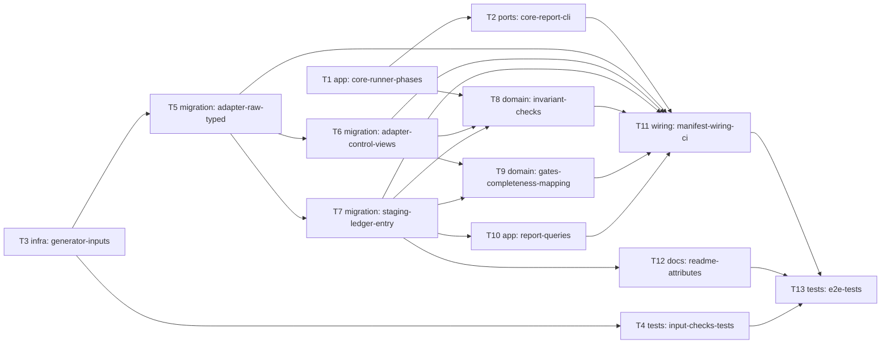

# Epic — unified-gl-inputs

> **Spec:** [spec.md](../spec.md) · **Design:** [sad.md](../sad.md) · **Data model:** [data-model.md](../data-model.md) · **API:** [cli.md](../contracts/cli.md) (surface `cli`, no OpenAPI) · **ADRs:** [adr/](../adr/)

## Goal

Ship roadmap step 2: two synthetic ERP exports that visibly differ are loaded and aligned into one set of ledger entries (`staging.ledger_entry`) in transaction currency, each entry traceable to its source, guarded by a completeness gate and a mapping gate, runnable with one command (spec §2 Goals).

## Scope

- **In:** `fdp_core` extensions (invariants phase, report rendering, exit codes), `products/unified_gl/` (generator and synthetic inputs, DuckDB adapter, neutral staging SQL, invariants, two gates, report queries, manifest, README), CI timed run, tests.
- **Out:** currency conversion and the mandated gates (step 3), corrupted data and failing-gate demos (step 4), Databricks adapter and any compatibility claim (step 6), reader docs and sample output (step 5), real data and incremental loads (spec §3).

## Task map

Critical path: T3 → T5 → T7 → T9 → T11 → T13. Parallel branches: T1 ‖ T3 at the start; T8 ‖ T9 ‖ T10 ‖ T12 after T7. Migration-layer tasks (T5, T6, T7) are serialized by `implement`.

## Tasks

See [tracker.md](./tracker.md) for status. Machine contract: [tasks.json](../tasks.json).

| # | Task | Layer | Blocked by | DoD (short) |
|---|---|---|---|---|
| T1 | [Extend the runner with manifest keys, clean start, invariant phase and InvariantViolation](./core-runner-phases.md) | app | — | Runner executes invariants before gates, raises InvariantViolation on a returned row and clears stale report files; unit tests with a throw-away product pass. |
| T2 | [Add report.py and extend the CLI: summary table, violating rows, exceptions line, reserved products, exit codes 2 and 3](./core-report-cli.md) | ports | T1 | CLI prints summary, gate lines, violating rows, exceptions line and reserved products in the contract order and returns exit codes 0/1/2/3; unit tests pass. |
| T3 | [Write the seeded data generator and commit the five synthetic input files](./generator-inputs.md) | infra | — | Generator writes five byte-identical synthetic files (100-250 entries per export, Q1 2026, EUR/GBP/USD, balanced documents, daily rates) and returns the expected aligned entries. |
| T4 | [Test the committed inputs: reproducibility hash, size, quarter, keys, balance, currencies, daily rates, synthetic names](./input-checks-tests.md) | tests | T3 | Tests prove byte-identical regeneration, size, first-quarter dates, balanced documents, currencies, daily rates and synthetic file names. |
| T5 | [Create the DuckDB adapter files: raw load of the five inputs and the typed views](./adapter-raw-typed.md) | migration | T3 | DuckDB adapter loads the five inputs as they arrived and exposes raw.typed_erp_a/typed_erp_b with NULL for unreadable values; adapter tests pass. |
| T6 | [Create the control views (independent raw side of the completeness gate)](./adapter-control-views.md) | migration | T5 | Control views re-read the raw tables with a separate parse; every unreadable-entry rule yields a row with NULL signed_amount; tests pass. |
| T7 | [Create staging.ledger_entry: the aligned entry set (neutral SQL)](./staging-ledger-entry.md) | migration | T5 | staging.ledger_entry holds every readable entry of both sources in one shape with signed amount, group account, common description and deterministic entry_id; tests against the generator's expected entries pass. |
| T8 | [Write the three invariant SQL checks: unique document and line, unique entry id, unambiguous mapping](./invariant-checks.md) | domain | T1, T6, T7 | Three zero-row invariant SQL files stop the run on a repeated document+line, a repeated entry_id or an ambiguous mapping, naming the offenders; clean data returns zero rows; tests pass. |
| T9 | [Write the completeness gate and the mapping gate](./gates-completeness-mapping.md) | domain | T6, T7 | 01_completeness.sql and 02_mapping.sql return zero rows on clean data and the specified rows (source system, currency, difference; document and line; local account) on the corrupted tmp copies; tests pass. |
| T10 | [Write the summary query and the exceptions report query](./report-queries.md) | app | T7 | summary.sql returns entries and debit/credit totals per source system and currency present; exceptions_report.sql returns aligned entries without an exact translation row; tests pass. |
| T11 | [Activate unified_gl: product.toml manifest, smoke-test update, timed CI run](./manifest-wiring-ci.md) | wiring | T2, T5, T6, T7, T8, T9, T10 | product.toml activates unified_gl with all manifest keys; make run succeeds end to end, the smoke test is updated and CI runs a timed make run. |
| T12 | [Document the aligned entry attributes and the synthetic-data notice in the product README](./readme-attributes.md) | docs | T7 | Product README documents all aligned-entry attributes, states the data is synthetic, and explains gates, invariants, exit codes and reports. |
| T13 | [End-to-end tests: five source differences, known values, traceability, exceptions report, exit codes](./e2e-tests.md) | tests | T11, T12, T4 | Integration tests prove the five source differences, equality with the generator's known values, traceability to raw records, the summary/exceptions output and exit 0 for the clean run. |

## Risks / Hard rules

- Product SQL is dialect-neutral; engine-specific code only in `products/unified_gl/adapters/<engine>/` (spec §6, repo ADR-0004).
- The control views must not reuse the typed views or their parsing (feature ADR-0002).
- Invariant violations stop the run with exit 2 and a typed error; a failed gate is a result with exit 1 (feature ADR-0003, repo ADR-0003).
- Shared behaviour lives in `src/fdp_core/`, never copied into a product; IDs are deterministic hashes (CLAUDE.md).
- A run writes only to `build/` and never changes committed inputs (AC-12).
- Time budget (sad §11): cut order from spec §1 if the 10+ hours run out.
- Staged migration files under `docs/features/unified-gl-inputs/migrations/` are promoted by `implement` into `adapters/duckdb/` and `sql/staging/`; never edit the live copy and the staged copy independently.
