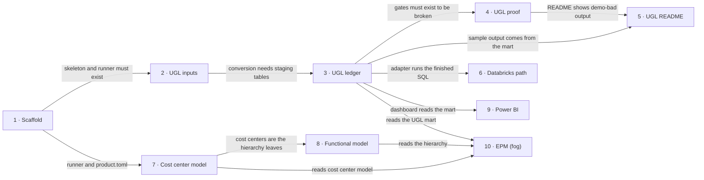

# Roadmap — finance-data-products

> **A decomposition, not a promise.** The overall idea broken into incremental steps: what each
> step is, where it comes from, how big it is — or that nobody has looked at it yet — and in which
> order, and parallel lanes, we walk them. **No dates** (except shipped history), **no scores** —
> order is the prioritization. The *solution* for any step lives in its `docs/features/<slug>/`
> spec, not here.

## Destination

A reviewer can clone the repo, run one command and watch Unified GL turn two ERP exports into one USD ledger with quality gates that visibly fail on deliberately corrupted data, alongside working Cost center and Functional operating models and a reserved place for EPM.

## Steps

| # | Step | Source | Size | Status |
|---|---|---|:---:|---|
| 1 | Scaffold: repo skeleton with `fdp_core`, Makefile, pytest, CI and the four reserved product folders | architecture-map.md "Module inventory" | S | idea |
| 2 | Unified GL, inputs: two synthetic ERP exports in different formats and currencies loaded through raw and staging | idea-brief.md §1 Raw idea (product 1) | M | shipped — [features/unified-gl-inputs](features/unified-gl-inputs/spec.md) |
| 3 | Unified GL, ledger: convert to USD, gate "rate exists on date", gate "totals reconcile before/after conversion", publish the mart, `make run` end to end | idea-brief.md §2 Problem (criterion a) | M | idea |
| 4 | Unified GL, proof: `make demo-bad` plus red and green tests show the gates fail on corrupted data. Includes wiring `--bad`: the flag is parsed (`Config.bad`) but the runner ignores it, so today `make demo-bad` exits 0 (found in review of unified-gl-inputs, 2026-11-07) | idea-brief.md §2 Problem (criterion b) | S | idea |
| 5 | Unified GL, reader view: product README with diagram and sample output, plus the repo front page with the product map | idea-brief.md §2 Problem (criterion c) | S | idea |
| 6 | Databricks path: thin adapter that runs the same product SQL on Databricks | idea-brief.md §7 Recommendation | M | idea |
| 7 | Cost center model: reference model from synthetic CSV with gates for unique ID, required fields, valid owner | idea-brief.md §1 Raw idea (product 2) | S | idea |
| 8 | Functional operating model: function > sub-function > department > cost center hierarchy, gates for orphans, cycles and exactly one parent, Mermaid tree output | idea-brief.md §1 Raw idea (product 3) | M | idea |
| 9 | Power BI dashboard over the Unified GL mart | idea-brief.md §8 Open questions | M | idea |
| 10 | EPM: profitability by function with simple allocation rules → see [Not yet specified](#not-yet-specified) | idea-brief.md §1 Raw idea (product 4) | fog | idea |

## Not yet specified

| Area | What we'd have to learn | Blocks | How it gets sharpened |
|---|---|:---:|---|
| EPM (profitability by function) | Which allocation rules count as "simple", what the function-level P&L looks like, and which mart columns of steps 3, 7 and 8 it reads | 10 | Recon pass after steps 3, 7 and 8 have shipped; the brief reserves EPM and does not build it this cycle |

## Out of scope

- Real ERP connections and real financial data — the repo is a demo with synthetic data (idea-brief.md §5).
- Production requirements (SLA, security of real data, support) — the repo is a portfolio demo (idea-brief.md §5).

## Open decisions

| # | Question | Type | Owner | Blocks |
|---|---|:---:|:---:|:---:|
| D2 | How is a Power BI artifact produced and verified from macOS, and can a reviewer open it without Power BI Desktop? | research | agent | 9 |

## Decisions so far

- Python 3.12 with DuckDB executing SQL files → [`ADR-0001`](adr/0001-use-python-duckdb-with-sql-files.md)
- Repo organized as `products/<name>/` folders plus a shared `fdp_core` → [`ADR-0002`](adr/0002-organize-as-products-folders-plus-shared-core.md)
- DuckDB file rebuilt from raw/staging/mart SQL layers, no migration tool → [`ADR-0003`](adr/0003-rebuild-layered-duckdb-no-migration-tool.md)
- One dialect-neutral SQL source shared by the local and Databricks paths via a thin adapter → [`ADR-0004`](adr/0004-share-sql-across-local-and-databricks.md)
- Both execution paths are built, against the interviewer's recommendation of local only; products 2 and 3 are cut first when time runs out → [`idea-brief.md`](idea-brief.md) §6 and §7
- Power BI becomes its own step (9) instead of being left as an open question → [`idea-brief.md`](idea-brief.md) §8
- D1 closed: the owner has access to Databricks Free Edition, so the adapter can be run for real at step 6 (decided 2026-11-04) → [`unified-gl-inputs/spec.md`](features/unified-gl-inputs/spec.md) §1 and §6

## Dependency graph

## Execution path

Zones are marked `(new)` because the repo has no code yet; they come from the target layout in `docs/architecture-map.md`. Step 10 is fog and enters no wave.

| Wave | Steps | Zone per step (why parallel-safe) | Unlocks |
|:---:|---|---|---|
| 1 | 1 | repo root, `src/fdp_core/` (new), `products/*/` placeholders (new) | 2, 7 |
| 2 | 2 ∥ 7 | 2: `products/unified_gl/` (new) · 7: `products/cost_center_model/` (new) (disjoint) | 3, 8 |
| 3 | 3 ∥ 8 | 3: `products/unified_gl/`, `src/fdp_core/fx.py` (new) · 8: `products/functional_model/` (new), `src/fdp_core/gates.py` (new) (disjoint) | 4, 5, 6, 9 |
| 4 | 4 ∥ 6 ∥ 9 | 4: `tests/integration/` (new), `Makefile`, `products/unified_gl/data/` · 6: `databricks/` (new) · 9: `powerbi/` (new), `src/fdp_core/export.py` (new) (disjoint) | 5 |
| 5 | 5 | `README.md` (new), `products/unified_gl/README.md` (new) | — |

## Shipped

| Step | Shipped | Link |
|---|---|---|
| 2 · Unified GL, inputs | 2026-11-08 | [changelog](features/unified-gl-inputs/changelog.md) · [PR #1](https://github.com/Shkilov75/finance-data-products/pull/1) |
